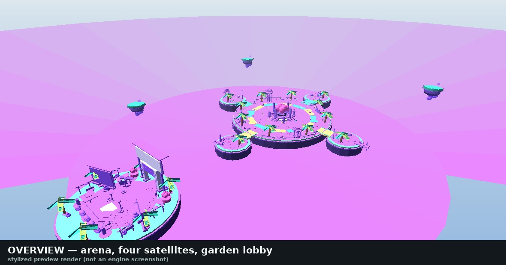
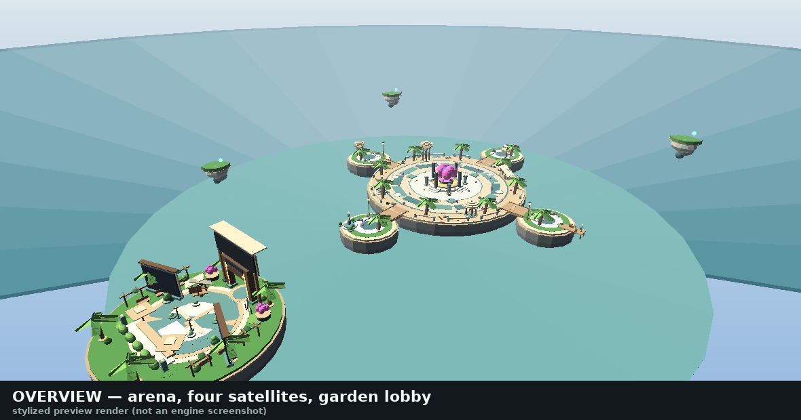
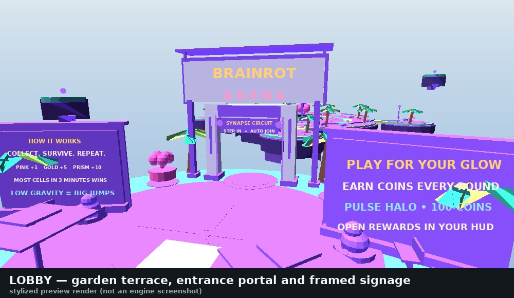
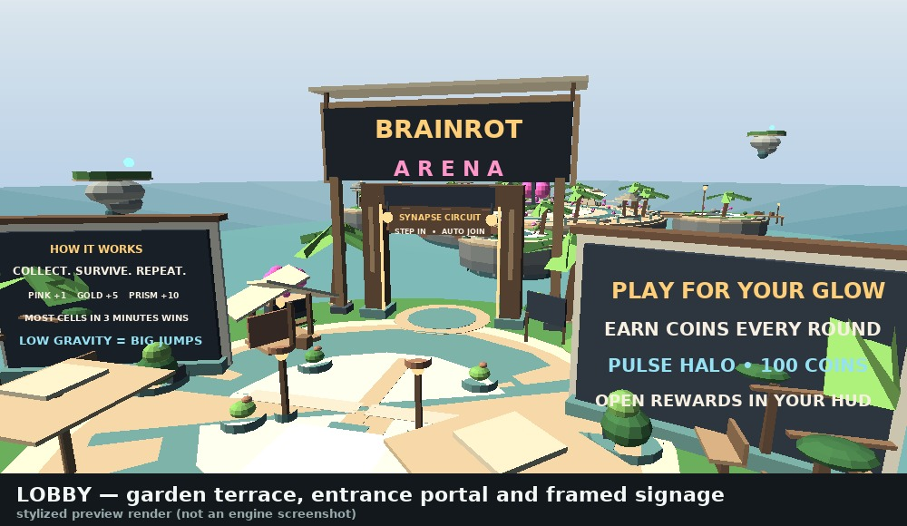
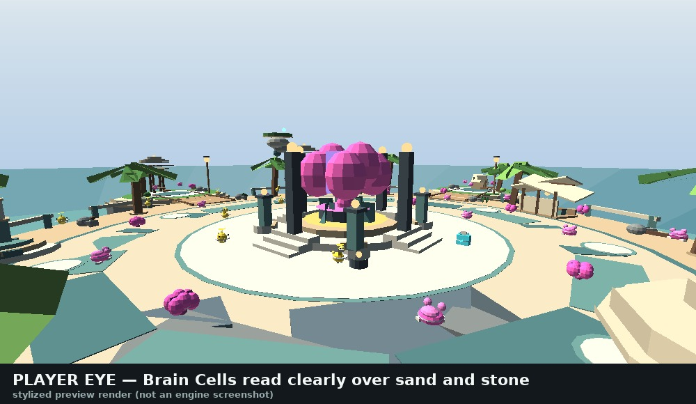

# BRAINROT ARENA — Visual Change Report

**Scope:** art direction only. Gameplay mechanics, scoring, the round system,
collectibles, coins/cosmetics and the multiplayer architecture were **not**
redesigned, retuned or rewritten.

**Status:** 158 automated checks pass, including a 24-test art-direction gate and a
frozen-geometry regression test proving every walkable surface, pickup position and
spawn is byte-identical to the pre-redesign build. Roblox Studio is not installed in
this environment, so **engine rendering remains unverified** — see
[What is verified](#what-is-verified-and-what-is-not).

---

## 1. The problem with the previous look

| Symptom | Cause in the old world | Effect |
|---|---|---|
| Cyan floors | `Arena_Turf` / `Satellite_*_Turf` at `(99, 218, 154)`, 33 `Neon` accents at `(66, 228, 247)`, cyan spawn pads | Everything competed for attention; the floor was the brightest object |
| Lime palm trees | Fan blades alternating `(158, 239, 91)` and `(47, 190, 141)` | Artificial, "radioactive" vegetation |
| Purple platforms | Rock mass `(67, 47, 119)` + `(105, 71, 169)` facets, purple trim rings, purple rails, purple arch, purple boards | The whole environment lived in one violet hue |
| Clashing accents | Every satellite had a different neon colour (`cyan`/`gold`/`purple`/`pink`) | Colour carried no meaning: pink meant both "collect this" and "decoration" |
| Flat materials | 325 of 358 parts were `SmoothPlastic` | No material variation, so form had to be read from colour alone |
| Washed-out grade | `CandyColor` correction at `Saturation 0.12` over already-saturated source colours | Over-saturated *and* flat |

Measured baseline: the old environment palette averages **CIELAB chroma 59** with
individual surfaces up to **91** (violet). Values above ~45 read as "neon" at
gameplay distance.

---

## 2. The new art direction

> **Premium stylized low-poly tropical environment, cinematic late-afternoon light,
> playful brainrot hero objects, polished Roblox game aesthetics.**

A floating tropical archipelago at 15:20: pale sand shores, a teal stone court, a
garden terrace lobby and **one** ceremonial brain beacon. Colour is now information
rather than decoration — four explicit hierarchy layers, each with its own
saturation budget:

| Layer | What lives there | Mean chroma | Rule |
|---|---|---|---|
| **1 — Ground** | sand, sandstone, limestone, teal stone courts | **13.9** | quietest surface on screen |
| **2 — Nature & rock** | tropical palms, lawns, boulders, cliffs | **32.0** | natural, never neon |
| **3 — Built props** | timber decks, canvas, lanterns, signage | **16.0** | recedes; frames the action |
| **4 — Hero objects** | Brain Cells, beacon, gate light rails | **54.4** | the only saturated hues in the scene |


*Before: violet islands, cyan rings, lime fronds, every satellite a different neon.*


*After: sand and teal islands, tropical green, one pink beacon as the focal point.*

---

## 3. What changed, requirement by requirement

### 3.1 Neon cyan surfaces → natural teal, stone and sand
- Arena floor `(99, 218, 154)` → **sand `(226, 204, 168)`** with a `Sand` material.
- Added a layered court, new geometry but zero new walkable surface: wet-sand shore
  ring → sandstone court border → cut-stone court → marble centre disc.
- The 12-part circuit inlay became a **stone intaglio** (slate, 0.07 studs proud)
  instead of alternating yellow/mint neon strips.
- Spawn pads: neon cyan discs → pale limestone medallions on a teal lip.
- Island cliffs now read as geology: `Rock` band, `Basalt` lower band, `Slate`
  keel, `Pebble` shoreline — four materials instead of one flat violet.

### 3.2 Lime vegetation → natural tropical greens
- `(158, 239, 91)` lime and `(47, 190, 141)` teal-green → **`(88, 142, 76)` /
  `(124, 172, 90)` / `(62, 108, 64)`** — three greens used for shading, not variety
  for its own sake.
- Palms kept their collidable trunks: added a pebble base ring, a darker crown bud,
  and drooping **frond tips** so the crown reads as foliage instead of a bracelet.
- Satellites gained a grass heart (`Grass` material) inside the sand shelf.

### 3.3 Purple platforms → removed from architecture
- **Zero purple in the environment.** Rock, trim rings, rails, rail posts, arch,
  bridges and all four boards no longer contain violet.
- The only purple left in the world is one **energy seam** inside each hero brain
  (beacon + the two lobby shrines); `tools/artcheck.py` asserts this.

### 3.4 Soft blue sky with atmospheric lighting
| Property | Before | After | Why |
|---|---|---|---|
| `ClockTime` | 14.2 | **15.4** | longer shadows, warmer key light |
| `Ambient` | `(135,122,185)` violet | **`(96,108,122)`** | cool sky-bounce fill, not magenta |
| `OutdoorAmbient` | `(153,177,211)` | **`(150,164,176)`** | neutral daylight sky fill |
| `ColorShift_Top` | – | **`(255,238,214)`** | warm sun tint |
| `ColorShift_Bottom` | – | **`(122,140,152)`** | cool ground bounce |
| `FogColor` / `FogStart`/`End` | `(151,213,255)`, 160→700 | **`(198,216,228)`, 260→1150** | soft blue haze, distance readable |
| `Atmosphere` | density .25, decay violet | **`CoastalHaze`** .32, decay `(146,166,190)`, haze 1.6 | aerial perspective |
| `GlobalShadows` / `ShadowSoftness` | on / default | **on / 0.34** | soft, cinematic contact shadows |
| `ExposureCompensation` | – | **+0.06** | gentle lift |
| `GeographicLatitude` | – | **12°** | tropical sun angle |

### 3.5 Warm sunlight, ambient shadows, material variation
- **Warm key light** via `ColorShift_Top` + a 15:20 sun; **seven shadowless point
  lights** (beacon `BeaconGlow` 2.2/36 studs, two `GateWarmth` lanterns, four
  satellite `MastWarmth` lanterns) provide warm local pools without shadow cost.
- `CastShadow` is now authored **per part** (327 of 588 cast, i.e. 56%) instead of
  "everything except neon". Neon never casts.
- **14 distinct materials** now in use: `Sand, Sandstone, Limestone, Marble, Rock,
  Basalt, Slate, Pebble, Grass, LeafyGrass, WoodPlanks, Fabric, SmoothPlastic,
  Neon`. Before: 2 (`SmoothPlastic`, `Neon`).

### 3.6 Pink / purple / yellow reserved for gameplay
- Cell rarity colours are **unchanged** (`{255,94,190}`, `{255,213,67}`,
  `{83,238,255}`), so the HUD key, effects and server contract still match.
- Environment geometry is gated at chroma ≤ 40 (≤ 45 for living lawn, ≤ 52 for
  foliage highlights); the old palette sat at 40–91.
- A test fails the build if any environment part reuses a legacy neon value.

### 3.7 Visual hierarchy of lobby and arena
- **Arena:** beach ring → stone court border → court → marble centre → circuit
  inlay → beacon steps → four framing columns → brain. The beacon is the tallest,
  most saturated object and sits exactly on the arena centreline (asserted).
- **Lobby:** lawn → sandstone plaza → limestone centre → four-ray compass rose →
  continuous paving band → benches/planters/umbrellas → gate → title board.
- The old 16-piece "confetti ring" (four clashing neon colours scattered around the
  plaza) was a visual hierarchy anti-pattern; it is now one continuous paving band.

### 3.8 Entrance portal and signage
- **Portal:** timber gate (unchanged collidable frame) now has stone feet, vertical
  beams, two warm lanterns with brackets, two warm gold light rails, a stone
  medallion landing on the ground, and a hanging **"SYNAPSE CIRCUIT / STEP IN •
  AUTO JOIN"** banner inside the opening.
- **Title board:** dark charcoal panel (matching the HUD) in a timber frame, on two
  posts with stone feet, a limestone surround, a timber cap and a canvas awning.
  Wordmark set in *GothamBlack* for optical weight; contrast 7.0:1.
- **Map boards:** each now has a limestone frame, a stone plinth, a timber cap — and,
  critically, was **re-oriented to face the spawn approach** (previously they pointed
  away from the players walking to the gate).
- All signage uses self-lit `SurfaceGui` (`LightInfluence = 0`) with a warm-dark
  text stroke, so it stays legible in shadow and at dusk.


*Before: violet gate, unreadable pale-on-pale wordmark, boards facing away.*


*After: timber gate with warm lanterns, legible signage facing the approach.*

### 3.9 Every gameplay object stays easy to identify
Colour is no longer the only cue. Each rarity also has a **silhouette**, built from
primitives in the new `src/client/Iconography.luau`:

| Cell | Colour | Silhouette | Extra parts |
|---|---|---|---|
| Pink **+1** | `(255,94,190)` | lobed brain + pale equatorial halo | 1 |
| Gold **+5** | `(255,213,67)` | …plus a vertical crown spike | 2 |
| Prism **+10** | `(83,238,255)` | …plus two crossed arms | 3 |

- Marks are **lazily allocated**: common cells pay zero extra parts.
- A neutral (white) halo guarantees separation from pale sand/stone; the gate
  asserts every cell colour is ≥ 30 ΔE from every floor it can float over.
- The HUD rarity key now shows these glyphs next to `PINK +1 / GOLD +5 / PRISM +10`.


*Player eye level: cells read against sand, sandstone and marble.*

### 3.10 Performance on lower-end PCs and mobile
The environment grew richer **without** raising the runtime cost materially:

| Metric | Before | After |
|---|---|---|
| Static geometry parts | 358 | **588** (601 instances in the place, incl. 13 bake-only sign boards) |
| Total runtime parts incl. client cells | 790 | **1,020** |
| Materials | 2 | **14** |
| Point lights | 1 (28-stud) | **7 (all shadowless, ≤ 36 studs)** |
| Shadow casters | 325 | **327** (56% of parts) |
| Post-processing | Bloom .3 + saturated grade | Bloom .22 (threshold 1.45) + neutral grade |
| Cheap effects only | – | Sky, Atmosphere, Bloom, ColorCorrection (no DOF/blur/sun-rays) |

Deliberate budget rules, enforced by tests: ≤ 640 static parts, ≤ 1,060 total runtime
parts, ≤ 7 lights, no shadowed point lights, ≤ 0.3 bloom intensity and ≥ 1.3 bloom
threshold (so only genuinely bright gameplay glow blooms). Distant decoration
remains non-colliding, non-queryable and non-touching.

---

## 4. Gameplay integrity

Nothing in the gameplay path was touched: `RoundMachine`, `PickupLedger`,
`MovementGuard`, `Main.server` timing/scoring/coins/halo, remote names, remote verbs,
rate limits, `Config` timings, gravity values and pickup positions are unchanged.

A new regression test (`tools/artcheck.py::test_18` / `test_19`) compares the live
world against `tests/fixtures/world-baseline.json`, frozen **before** the redesign:

```
95 collidable parts compared → Position, Size, Rotation, Shape, Class all identical
48 pickup positions → identical (all at y = 23.5, all with walkable floor)
8 arena spawns + 8 lobby spawns → identical
```

The only collidable parts that moved are the four **signage panels** (decorative
boards, excluded explicitly): the status board relocated onto the arch beam and the
banner got a tighter aspect ratio. No walking surface, bridge, rail, beacon step or
spawn pad changed.

### Unchanged files (verified against the branch base)

```
src/server/core/RoundMachine.luau    UNCHANGED   round phases, scoring, rewards, halo ownership
src/server/core/PickupLedger.luau    UNCHANGED   atomic claim, respawn generations
src/server/core/MovementGuard.luau   UNCHANGED   movement sanity layer
src/shared/Config.luau               UNCHANGED   timings, gravity, rarity, coin values, prices
```

Gameplay diff for the two scripts that *did* change:

```diff
--- src/server/Main.server.luau
+local ArtService = require(script.Parent.ArtService)
+-- Appearance only. Idempotent with the lighting rig baked into the place file.
+ArtService.apply()
-        segment.Color = Color3.fromRGB(83, 238, 255)
+        segment.Color = Color3.fromRGB(126, 226, 250)      -- Pulse Halo tint only
```

`Main.server` changes by 5 lines total; no timing, scoring, remote, rate-limit,
pickup, reward or lifecycle logic was touched.

### Code changes (all additive except palette constants)

| File | Change |
|---|---|
| `tools/theme.py` | **new** — single source of truth: palette, materials, lighting rig, lights, hierarchy metadata |
| `tools/world.py` | rewritten environment spec; identical collidable transforms |
| `tools/build_place.py` | per-part materials/shadows, new lighting rig export, per-sign bake layer, generates `ArtDirection.luau` |
| `tools/artcheck.py` | **new** — 24-test art-direction gate |
| `tools/preview.py` | **new** — dev-only software preview renderer (numpy + Pillow) |
| `tools/check.py` | runs the art gate; reports updated counts |
| `src/shared/ArtDirection.luau` | **new**, generated — runtime mirror of the rig |
| `src/server/ArtService.luau` | **new** — idempotent lighting rig application |
| `src/server/WorldService.luau` | 27 lines: honours per-part material/shadow/light data, keeps `GothamBlack` sign lines, prismatic event accent |
| `src/server/Main.server.luau` | +5 lines: `ArtService.apply()` and one halo tint. No gameplay logic. |
| `src/client/Iconography.luau` | **new** — rarity silhouettes + HUD glyphs |
| `src/client/Effects.luau` | 33 lines: neutral halo, warm split, lazy rarity marks, gentler event grade |
| `src/client/Hud.luau` | 29 lines: warm-charcoal palette constants, rarity glyphs in the key. Layout, breakpoints and behaviour untouched. |
| `tests/adapters.spec.luau` | +3 art checks, updated part counts |
| `tools/verify_place.py` | material/shadow/light/signature export assertions |

---

## 5. Palette reference

| Token | RGB | Use |
|---|---|---|
| `sand` | `#E2CCA8` | arena floor, satellite shelves |
| `sand_light` | `#E7D6B7` | plaza paving |
| `sand_shade` | `#CBB18B` | medallions, court rings, umbrella canopy |
| `court_stone` | `#CFBFA4` | arena court surface |
| `teal_stone` | `#68928C` | court border, rails, planters |
| `teal_deep` | `#4E7676` | court lip, satellite inlay core |
| `limestone` | `#DFD8C5` | built stone, spawn medallions |
| `marble` | `#D8D1BE` | polished centre disc, beacon step |
| `rock` / `rock_light` | `#808482` / `#9C9D96` | island mass, boulders |
| `basalt` / `slate` | `#4A545C` / `#607078` | dark rock, inlay, keel |
| `pebble` | `#B7A081` | shoreline, palm bases |
| `leaf` / `leaf_light` / `leaf_dark` / `frond` | `#588C4C` / `#7CAC5A` / `#3E6C40` / `#689E52` | tropical vegetation |
| `trunk` / `trunk_dark` | `#7E5E46` / `#624A3A` | palms |
| `wood_light` / `wood` / `wood_dark` | `#B4926E` / `#967456` / `#705440` | bridges, benches, gate |
| `canvas` | `#D6C7AA` | awnings, umbrellas |
| `ink` / `panel` | `#262C36` / `#323A46` | signage panels, HUD |
| `lantern` | `#FFC88A` | warm lamp glow |
| `beacon_pink` / `beacon_gold` | `#FF84D6` / `#FFD674` | hero beacon only |
| `cell_pink` / `cell_gold` / `cell_prism` | `#FF68BE` / `#FFCE4A` / `#7AE6FF` | Brain Cells (gameplay) |

---

## 6. Regenerating everything

```sh
python3 tools/build_place.py   # WorldData.luau + ArtDirection.luau + both places
python3 tools/check.py         # 158 checks incl. the art-direction gate
python3 tools/preview.py       # after renders  -> docs/previews/*.jpg
python3 tools/preview.py --legacy   # before renders (frozen old palette)
python3 tools/package_release.py    # project ZIP + manifest + checksums
```

`tools/preview.py` is the only step needing third-party packages
(`pip install numpy pillow`); it is **never** required to open or play the game.

## 7. What is verified — and what is not

**Verified here (158 automated checks):**
- 72 core Luau rules tests, incl. 100 simulated 12-player rounds.
- 32 production adapter tests: the real server/client scripts run against mocked
  Roblox services, covering rounds, pickups, rescue, coins, halo, HUD bounds, the new
  lighting rig, authored materials and the cell-visual part budget.
- 30 XML/API/geometry export tests: every exported property is a real, loadable
  Roblox property; materials, shadow flags, point lights and sign fonts round-trip.
- **24 art-direction tests**: legacy palette absent, saturation ceilings per
  hierarchy layer, hierarchy monotonicity, natural-family dominance, purple
  restricted to hero brains, cyan restricted to neon gameplay accents, material
  variety, shadow budget, performance budgets, blue-sky/warm-sun lighting values,
  bloom/post-processing limits, export↔theme parity, cell-vs-floor ΔE, signage
  contrast, collidable-geometry and pickup/spawn freeze, portal clearance, landmark
  hierarchy, generated-module sync, no external asset IDs.
- Deterministic rebuild + whitespace check.

**Not verified (requires Roblox Studio):** actual engine rendering of the new
lighting/material/attenuation setup, the `Sky` texture availability in a Windows
Studio install, real device frame-rate on low-end mobile, and UI appearance at
runtime.

**About the images in `docs/previews/`:** they are a **standalone software render**
(`tools/preview.py`, numpy + Pillow — dev-only, never shipped) of the same geometry,
colour and material tables the exporter uses. They communicate composition, palette,
hierarchy and readability. They are **not** engine captures: the renderer draws a
simple two-stop sky so the "before" and "after" plates are directly comparable, and
it approximates shadows with a single directional term. Real `Sky`, `Atmosphere`,
sun warmth, soft shadows, bloom and material micro-surface come from the engine and
are exactly what the Studio pass must confirm.

**Suggested Studio pass:** open `places/BrainrotArena-QuickTest.rbxlx`, check Output
for errors, walk the lobby → gate → arena route at 15:20 light, confirm all three
rarities are distinguishable at distance on the lowest graphics quality setting, and
verify signage legibility from the spawn pad.
